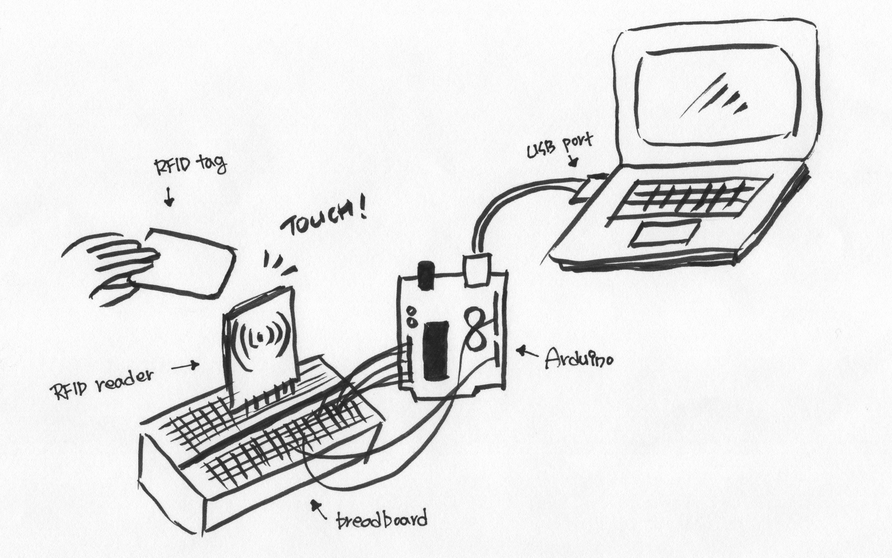
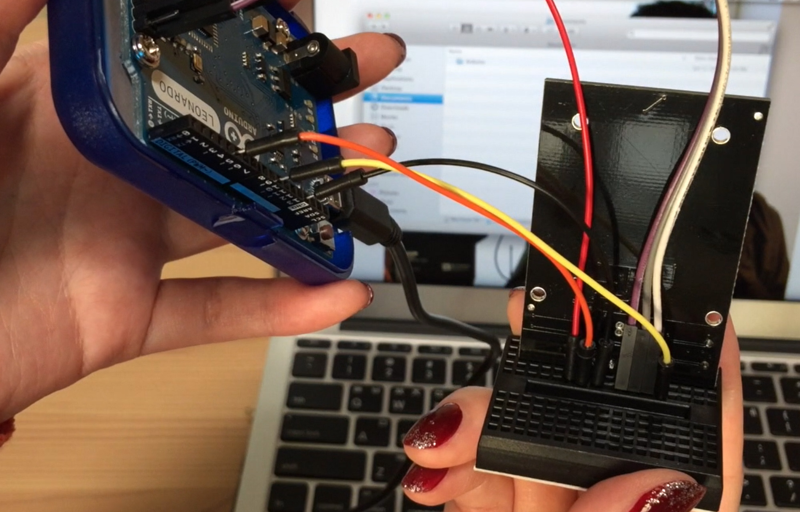
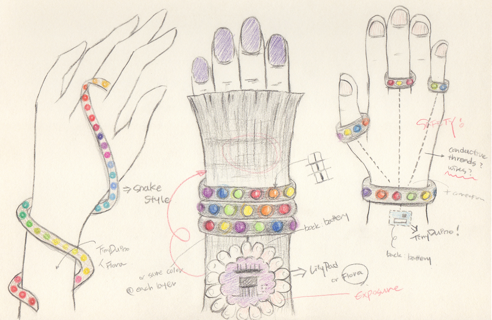
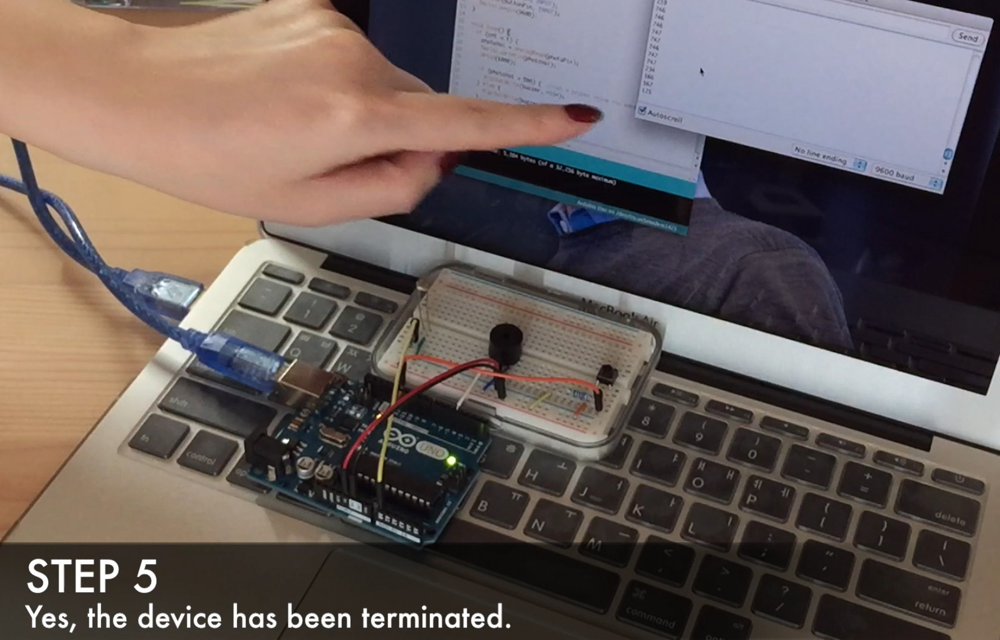
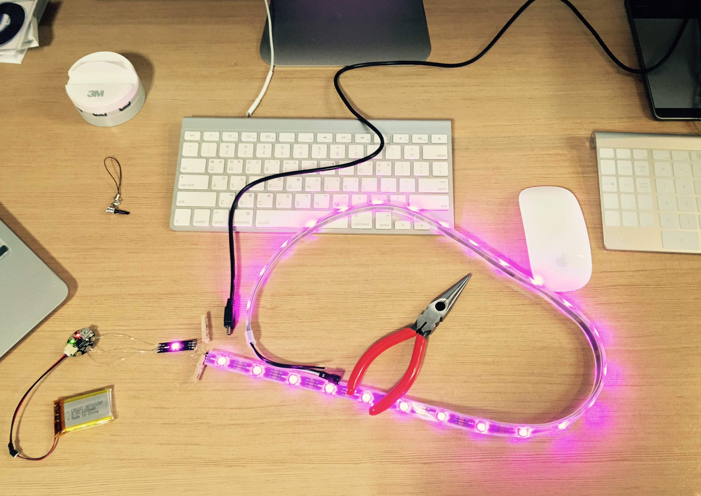

# 🔌 Arduino Throwback Toys 2015 🔌

### 💡 Built for fun, curiosity, and the joy of making things work in the physical world.

> I dug up a few Arduino toy projects I uploaded to YouTube in early 2015.<br>
> The videos are no longer available, but I found the original files on an old SSD.<br>
> A little cringe, but enjoy! 😂

---

### 1. OS X Password Input Automation Using Arduino Leonardo & RC522 RFID Module

Back in January 2015, Macs didn't have built-in fingerprint sensors, so logging in meant typing your password every time.
I didn't like having to type my password repeatedly, especially when I was concerned about exposing it to people nearby.<br>
So I built my own solution using an Arduino and an NFC reader. I modified the setup so that I could log in to my Mac simply by tapping my credit card against the reader.

[Download Higher-Quality Video (password_automation.mp4)](https://github.com/karmakaryx/arduino-throwback-toys/releases/download/v1.0/password_automation.mp4)

https://github.com/user-attachments/assets/a3104fb6-bed8-4e69-9594-2a8e8b72e0a7

(Music: Quickly made by me using GarageBand)



---

### 2. LED Bracelet Using Adafruit NeoPixel RGB LED Strip & Adafruit Gemma

I love electronic music and dancing, and I used to DJ as well. I was a big fan of clubbing (before I got too old for the club scene 😂), so I wanted to create something that would stand out on the dance floor.<br>
I designed and built an LED bracelet to catch people's attention in the club.

[Download Higher-Quality Video (led_bracelet.mp4)](https://github.com/karmakaryx/arduino-throwback-toys/releases/download/v2.0/led_bracelet.mp4)

https://github.com/user-attachments/assets/6308b88c-c68c-4f63-b695-55e890fe86db

(Music: Happy Sad by Pizzicato Five / Une Very Stylish Fille by Dimitri From Paris)<br>
*Music playback is only available when downloading the higher-quality video.*


- Adafruit Arduino: https://learn.adafruit.com/introducing-gemma/setting-up-with-arduino-ide
- NeoPixel library: https://github.com/adafruit/Adafruit_NeoPixel

---

### 3. Low-Illuminance Alarm Device Using Arduino Uno & Photocell
I used to be into houseplants, but as a night owl, I often forgot to open the blinds during the day. My Syngonium ended up growing leggy due to insufficient light.<br>
To solve this, I built a device that monitors ambient light levels and sounds an alarm when the light gets too low, reminding me that my plant needs more sunlight.

[Download Higher-Quality Video (light_alarm.mp4)](https://github.com/karmakaryx/arduino-throwback-toys/releases/download/v3.0/light_alarm.mp4)

https://github.com/user-attachments/assets/c76416bb-a428-435e-90d2-4845f18a2093

(Music: Quickly made by me using GarageBand)



---

### 📂 Directory
```
├── assets/...
├── 01_password_automation/
│   ├── MFRC522.h
│   └── login.ino
├── 02_led_bracelet/
│   ├── Adafruit_NeoPixel.h
│   └── bracelet.ino
├── 03_light_alarm/
│   └── alarm.ino
└── README.md
```


